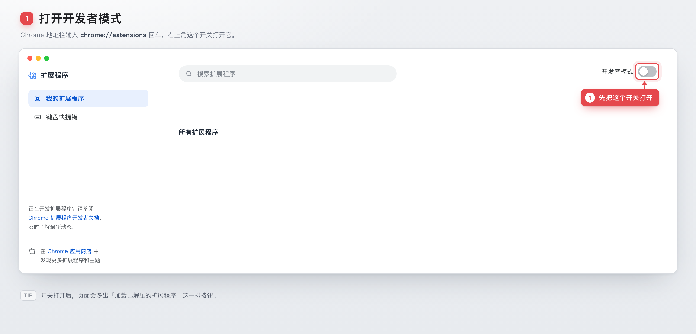
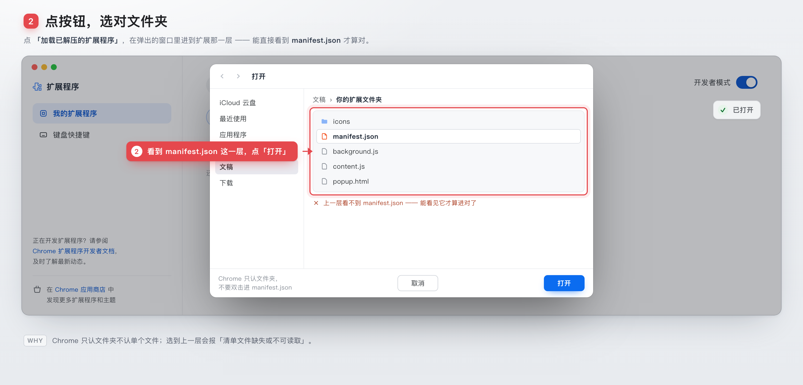
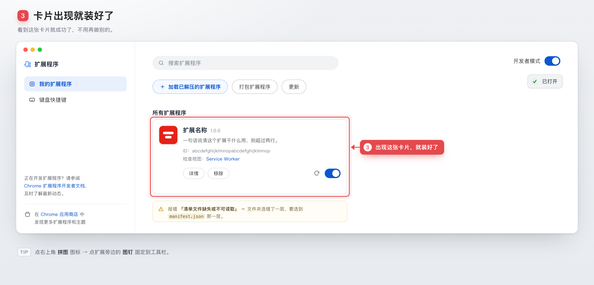

把「教别人在某个软件界面里点哪里」做成**带红框红标签的分步引导图**。

不是截屏拼贴 —— 是 **HTML 复刻界面 → 无头 Chrome 2x 截图 → 标注按元素自动定位**。

[为什么做这个](#why) · [快速开始](#quickstart) · [怎么工作的](#how) · [两条路线](#routes) · [版式规则](#rules) · [目录](#layout)

<a name="why"></a>


文字说「打开开发者模式，点加载已解压的扩展程序，选对文件夹」，
对面的人还是会问「哪个开关？」「选哪一层？」。

图能省掉这三轮来回。而且这类图不是一次性消耗品 —— 改文案重渲一次就行，不用重截。

| 第 1 步 | 第 2 步 | 第 3 步 |
|---|---|---|
|  |  |  |

完整长图：[`docs/demo/long.png`](docs/demo/long.png)（3000×4480，可直接发微信）

<a name="quickstart"></a>


需要：本机有 Chrome（或 Chromium / Edge / Brave）、Python 3.9+、Pillow（拼长图用）。

```bash
git clone <this-repo> handholding-guide
cd handholding-guide

# 1. 生成一个可编辑的工程（默认 Chrome 扩展页模板）
python scripts/new.py ./demo

# 2. 改 demo/index.html 里的 window.GUIDE（文案 / 指向 / 界面状态）

# 3. 渲图
python scripts/render.py --html demo/index.html --out demo/out \
  --names "01-开发者模式.png,02-选文件夹.png,03-装好了.png"
```

产出：三张 3000×1440 PNG + 一张 3000×4480 纵向长图。

其他用法：

```bash
python scripts/new.py ./demo --template blank      # 空骨架，自己搭界面
python scripts/render.py --steps all               # 单张总览（全部标注同屏）
python scripts/render.py --size 750x1334           # 手机竖版
python scripts/render.py --scale 3                 # 更高清
python scripts/render.py --no-stitch               # 不拼长图
```

<a name="how"></a>


一份 `index.html` 出 N 张图，靠 URL 参数 `?step=N` 切状态 —— 不用复制 N 份文件。

```js
window.GUIDE = {
  copy:  { '1': { ttl:'…', sub:'…', foot:'…' } },   // 标题 / 说明 / 页脚
  steps: { '1': [ { target:'#devSwitch', text:'先把这个开关打开', side:'below' } ] },
  onState(step) { /* 切界面状态：开关、显隐 */ }
};
```

标注只认元素 `id`，位置按 `getBoundingClientRect()` 现算 —— 改了界面不用重新数像素。

```bash
python scripts/render.py
# → index.html?step=1 → 01.png
# → index.html?step=2 → 02.png
# → index.html?step=3 → 03.png
# → Pillow 纵向拼成 long.png
```

<a name="routes"></a>


1. **HTML 复刻界面**（默认）。干净、可控、可重渲、无隐私泄露。适合 Chrome 系、macOS 对话框、iOS 设置页、常见网页后台。
2. **截图打底 + 空块打标**。界面太复杂（IDE、地图、有真实数据的后台）时用：真实截图当 `` 底图，标注指向盖在图上的空 `div`。见 [`references/components.md`](references/components.md)。

<a name="rules"></a>


完整版见 [`references/rules.md`](references/rules.md)。

- 一张图只讲一件事：当前步红色，已完成步降级成灰色 `✓`，未到达的步不出现。
- 卡点要讲死：「能看见 `manifest.json` 才算对」✅ /「选对文件夹」❌。
- 状态自洽：开关画成开着的，就别在文案里说「打开它」。
- 细节必须真：名称、版本号、ID、图标，一处 placeholder 会毁掉整张图的可信度。

<a name="layout"></a>


```
kit/          base.css（画布/标题/页脚/红框标签）· annotate.js（标注引擎）
templates/    chrome-extension.html（默认）· blank.html（空骨架）
scripts/      new.py（脚手架）· render.py（渲染 + 拼长图）
references/   rules.md（10 条版式硬规则）· components.md（已复刻界面 + 加新组件）
docs/svg/     README 装修用的 SVG 组件 + gen.py（改文案重跑即可）
SKILL.md      给 AI agent 用的触发说明与工作流
```

本 README 的首屏和章节标题都是 `docs/svg/gen.py` 生成的 SVG（1200×320 / 1200×138），
正文仍是 Markdown —— 兼顾好看、可搜索、可阅读。

## 当成 Agent Skill 用

仓库结构就是 skill 结构，直接放进 skills 目录即可：

```bash
git clone <this-repo> ~/.workbuddy-ai/skills/手把手教程图
```

## License

MIT
